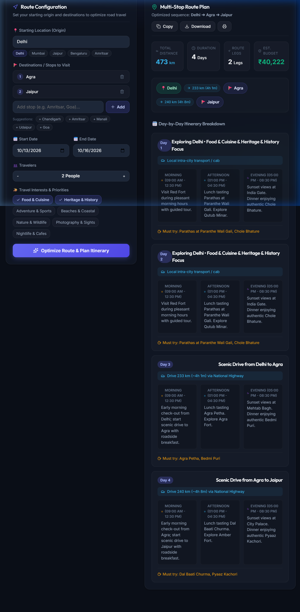

# 🗺️ RouteWise AI — Multi-Stop Agentic Route Planner

[](https://react.dev/)
[](https://langchain.com)
[](https://langchain-ai.github.io/langgraph/)
[](https://crewai.com)
[](https://python.org)

An autonomous **Agentic AI** travel and route recommendation system that takes natural-language origin and multi-stop destinations, determines mathematically optimal road travel sequences, interacts with real-world distance calculation tools, and synthesizes detailed day-by-day itineraries.

---

## 📸 Website Preview



---

## 🚀 Key Highlights & Agentic Features

* **⚡ Ultra-Fast React Frontend**: Minimalist, dark-mode glassmorphic UI built in React 19 + Vite for zero-lag presentation and fluid user interaction.
* **🤖 Grounded in Reality (No Hallucinations)**: Unlike standard chatbots that hallucinate road distances, RouteWise AI queries real road matrices and Geoapify routing engines to guarantee physical distance accuracy.
* **🔄 The ReAct Pattern (Reasoning + Acting)**: Implements cyclic state graph loops (`Thought ➔ Action ➔ Observation ➔ Loop`) in LangGraph.
* **👥 Multi-Agent Role Specialization (CrewAI)**:
  * **Route Optimizer**: Evaluates pairwise road distances and computes the shortest visiting sequence.
  * **Destination Researcher**: Pulls local culture, sightseeing attractions, and signature cuisine.
  * **Trip Planner**: Synthesizes travel constraints into a structured, chronologically viable schedule.
* **🧠 Persistent State & Memory**: Implements thread-level checkpointers (`MemorySaver`) to remember conversational context across multi-turn interactions.
* **📥 One-Click Export**: Copy markdown, download `itinerary.md`, or print ready-to-use travel plans.

---

## 🏗️ System Architecture

```
                    ┌──────────────────────────────┐
                    │      USER / PRESENTATION     │
                    │   React 19 + Vite Dashboard  │
                    └──────────────┬───────────────┘
                                   │ Origin, Stops, Dates, Interests
                                   ▼
                    ┌──────────────────────────────┐
                    │  ENVIRONMENT & TOOL LAYER    │
                    │  • Geoapify Routing API      │
                    │  • Road Highway Matrix       │
                    │  • order_stops() State       │
                    └──────────────┬───────────────┘
                                   │ Verified Pairwise Highway Legs
                                   ▼
                    ┌──────────────────────────────┐
                    │  AGENTIC REASONING ENGINE    │
                    │                              │
                    │  1. Destination Researcher   │
                    │     (Attractions & Food)     │
                    │              │               │
                    │              ▼ (Context)     │
                    │  2. Trip Planner Architect   │
                    │     (Day-by-Day Schedules)   │
                    └──────────────┬───────────────┘
                                   │ Structured Plan
                                   ▼
                    ┌──────────────────────────────┐
                    │   PRESENTATION & EXPORT      │
                    │  • Total Km & Leg Durations  │
                    │  • Visual Timeline Badges    │
                    │  • Markdown Download         │
                    └──────────────────────────────┘
```

---

## 🛠️ Project Structure

```
T14_ROUTE_PLANNER/
├── assets/
│   └── screenshot.png          # UI presentation screenshot
├── frontend/                   # Ultra-fast Minimalist React UI
│   ├── src/
│   │   ├── App.jsx             # Main interactive application
│   │   ├── App.css             # Minimalist glassmorphic styling
│   │   ├── index.css           # Design tokens & color system
│   │   └── utils/
│   │       └── routePlannerEngine.js # Client-side routing & agent pipeline
│   ├── index.html
│   ├── package.json
│   └── vite.config.js
├── tools/
│   ├── __init__.py
│   └── tools.py                # Geoapify API, get_distance & order_stops
├── agents.py                   # CrewAI agent personas (Researcher, Planner)
├── tasks.py                    # CrewAI task specifications & context passing
├── crew.py                     # CrewAI sequential orchestrator
├── app.py                      # Streamlit reference interface
├── agent_demo.ipynb            # LangGraph ReAct Agent demonstration
├── AGENTIC_AI_AND_WORKFLOW.md  # In-depth architectural & viva explanation guide
├── VIVA_EXPLANATION.md         # Comprehensive Q&A defense cheat sheet
├── requirements.txt            # Python dependencies
├── package.json                # Root npm shortcut runner
└── README.md
```

---

## ⚡ Quickstart Guide

### 1. Run the Modern React Frontend (Recommended)

Make sure you have [Node.js](https://nodejs.org) installed:

```bash
# Install dependencies (first time only)
cd frontend
npm install

# Start the development server
npm run dev
```

Open your browser at **`http://localhost:5173/`**.

> **Tip:** You can also run `npm run dev` directly from the root project directory!

---

### 2. Run the LangGraph ReAct Notebook Demo

```bash
# Activate virtual environment
.venv\Scripts\activate   # Windows
# source .venv/bin/activate # macOS/Linux

# Launch Jupyter Notebook
jupyter notebook agent_demo.ipynb
```

---

## 🎓 Viva & Exam Defense Talking Points

* **Why is this Agentic AI?**  
  Because the system doesn't generate speculative answers in a single pass—it autonomously calls external calculation tools, reasons about road distances, divides responsibilities across specialized agent personas, and persists state across turns.
* **Why LangGraph?**  
  Standard LangChain forms linear pipelines (DAGs). Autonomous agents require **cyclic execution loops** to inspect observations and retry until conditions are satisfied. LangGraph manages this state graph with `MemorySaver` checkpointing.
* **Why CrewAI?**  
  Enforces clean separation of concerns: the *Researcher* focuses purely on cultural/culinary domain intelligence, while the *Planner* focuses strictly on timeline, budget, and transit feasibility.

---

## 📄 License

MIT License • Developed for the **T14 Multi-Stop Route Planner** Agentic AI Showcase.
